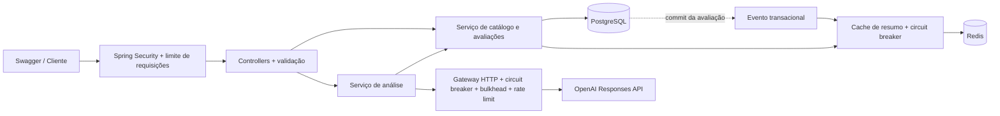

# Ratings & Reviews API

API de avaliações de produtos em **Java 21 e Spring Boot**, com persistência PostgreSQL, cache Redis e análise opcional por IA. Projeto de portfólio voltado a decisões de engenharia que podem ser demonstradas localmente: consistência, autorização, limites de recursos, resiliência e testes com dependências reais.

[](https://github.com/JeffeMartins/ratings-reviews-api/actions/workflows/ci.yml) [](https://github.com/JeffeMartins/ratings-reviews-api/actions/workflows/codeql.yml) [](LICENSE)

## Executar em poucos minutos

Pré-requisito: **Docker Desktop com engine Linux e Docker Compose v2**, com aproximadamente 2 GB livres para os serviços e espaço adicional para imagens/build. Java e Maven no host são opcionais para executar via Docker.

```powershell
git clone https://github.com/JeffeMartins/ratings-reviews-api.git
cd ratings-reviews-api
powershell -ExecutionPolicy Bypass -File scripts/setup.ps1
docker compose up -d --build --wait
powershell -ExecutionPolicy Bypass -File scripts/smoke.ps1
```

O primeiro build baixa imagens e dependências. O script de configuração gera senhas aleatórias no `.env`, preservando um arquivo existente. O smoke cria um produto e uma avaliação e verifica seu resumo. Pode ser executado novamente, criando novos produtos.

| Recurso | Endereço |
| --- | --- |
| Swagger UI | http://localhost:8080/swagger-ui.html |
| Contrato OpenAPI | http://localhost:8080/v3/api-docs |
| Produtos | http://localhost:8080/api/v1/products |
| Health | http://localhost:8080/actuator/health |
| Liveness | http://localhost:8080/actuator/health/liveness |
| Readiness | http://localhost:8080/actuator/health/readiness |
| Métricas Prometheus | http://localhost:8080/actuator/prometheus (admin) |

No Swagger, clique em **Authorize**. Use `admin` e o valor de `ADMIN_PASSWORD` do seu `.env` para criar produtos/analisar; use `reviewer` e `REVIEWER_PASSWORD` para avaliar. Execute `GET /api/v1/csrf` para inicializar o cookie de proteção; o Swagger envia o header CSRF nas escritas automaticamente. As leituras são públicas. O Swagger apresenta o esquema Basic globalmente por conveniência; a tabela abaixo descreve a autorização efetiva.

Linux/macOS: copie `.env.example` para `.env`, substitua as três senhas por valores aleatórios de pelo menos 16 caracteres, execute `docker compose up -d --build --wait` e use Swagger ou curl. Os scripts `.ps1` também funcionam com PowerShell 7.

## Funcionalidades e contrato

Base: `/api/v1`. IDs são UUIDs. Datas em UTC/ISO-8601. Coleções retornam `content`, `page`, `size`, `totalElements` e `totalPages`.

| Método | Rota | Permissão | Comportamento |
| --- | --- | --- | --- |
| GET | `/csrf` | Público | Inicializa o cookie CSRF para operações de escrita |
| GET | `/products?page=0&size=20` | Público | Lista produtos, ordem de criação decrescente |
| POST | `/products` | ADMIN | Cria produto; 201 e Location |
| GET | `/products/by-sku/{sku}` | Público | Produto, média de estrelas, total e avaliações/comentários paginados |
| POST | `/products/by-sku/{sku}/analysis` | ADMIN | Solicita análise opcional por SKU |
| GET | `/products/{id}` | Público | Consulta produto |
| GET | `/products/{id}/reviews` | Público | Avaliações paginadas, mais recentes primeiro |
| POST | `/products/{id}/reviews` | REVIEWER | Cria avaliação com autor obtido da identidade autenticada |
| DELETE | `/products/{id}/reviews/{reviewId}` | Autor ou ADMIN | Remove avaliação; 204 |
| GET | `/products/{id}/summary` | Público | Total de avaliações e média de notas |
| POST | `/products/{id}/analysis` | ADMIN | Solicita análise opcional por IA |

Regras: notas entre 1 e 5; nome/título até 160 caracteres; descrição/texto até 2.000; campos textuais obrigatórios; página entre 0 e 10.000; tamanho entre 1 e 100. Existe apenas uma avaliação por usuário/produto, garantida por restrição única no banco inclusive sob concorrência. Para substituir uma avaliação, remova a anterior e publique outra. A média é arredondada para duas casas; sem avaliações, retorna zero.

Exemplo de criação de produto:

```json
{"sku":"FONE-BT-001","name":"Headphone Bluetooth","description":"Fone sem fio para trabalho e música"}
```

Exemplo de avaliação:

```json
{"rating":5,"title":"Ótimo som","content":"Boa autonomia e encaixe confortável."}
```

Resumo:

```json
{"productId":"00000000-0000-0000-0000-000000000001","totalReviews":12,"averageRating":4.58}
```

### Demonstração pronta por SKU

```powershell
powershell -ExecutionPolicy Bypass -File scripts/seed-demo.ps1
curl.exe -sS "http://localhost:8080/api/v1/products/by-sku/FONE-BT-001"
```

O seed usa curl e as credenciais locais do `.env` para criar um produto fictício com duas avaliações (5 e 4 estrelas), média **4,5/5** e comentários em `reviews.content[].content`. Pode ser repetido sem duplicar o SKU ou as avaliações desses autores. Ele também consulta a análise: retorna `DISABLED` sem configuração de IA e pode consumir créditos se a integração estiver habilitada.

Na consulta por SKU, `product` contém o cadastro, `summary` contém `totalReviews` e `averageRating`, e `reviews` contém a página de avaliações (`rating`, `title`, `content`, `author`). `page` e `size` têm os mesmos limites das outras consultas. Os componentes podem refletir commits concorrentes diferentes; esse endpoint não promete um snapshot consistente entre resumo e lista, pois o resumo utiliza cache.

SKU aceita de 1 a 64 caracteres, iniciando com letra maiúscula ou número e contendo letras maiúsculas, números, ponto, hífen ou underscore. É único e pode ser enviado na criação; quando ausente, é gerado como `PRD-{UUID}`. A migration V2 atribui esse padrão aos produtos existentes sem alterar seus IDs. As rotas por UUID continuam disponíveis.

Erros de aplicação seguem `ProblemDetail` (`application/problem+json`). Validação retorna 400; credenciais ausentes/inválidas, 401; acesso proibido ou token CSRF ausente/inválido, 403; recurso ausente, 404; avaliação duplicada, 409; orçamento global excedido, 429 com `Retry-After`. A verificação CSRF pode retornar 403 antes da autenticação em escritas sem token. Respostas de autenticação/autorização são controladas pelo Spring Security e podem ter formato diferente. Stack traces e detalhes de SQL não são expostos.

Clientes de escrita devem manter cookies entre chamadas: primeiro `GET /api/v1/csrf`, depois enviar o valor atual do cookie `XSRF-TOKEN` no header `X-XSRF-TOKEN`, além da autenticação Basic e do mesmo cookie. Leia o cookie novamente antes de cada chamada: a autenticação pode rotacionar o token. O script smoke implementa esse fluxo. O handler preserva tokens mascarados nos atributos do request e aceita o token do cookie em headers JavaScript, seguindo o [padrão de integração do Spring Security](https://docs.spring.io/spring-security/reference/servlet/exploits/csrf.html).

## Arquitetura



Organização por responsabilidade e funcionalidade:

```text
src/main/java/dev/portfolio/ratings/
  api/       # Contratos HTTP, validação, erros e DTOs
  catalog/   # Produtos e casos de uso transacionais
  review/    # Avaliações, persistência e consulta agregada
  cache/     # Adaptador Redis e invalidação após commit
  ai/        # Análise e integração externa opcional
  config/    # Segurança, documentação e limite global
src/main/resources/db/migration/  # Schema versionado pelo Flyway
src/test/                        # Unitários e integração Testcontainers
scripts/                         # Setup, demonstração e carga
docs/                            # Decisões, operação e evolução
```

O serviço controla a transação; controllers não acessam repositórios. Entidades JPA não são retornadas como contratos HTTP. Open Session in View está desligado. SQL de agregação calcula total e média sem carregar avaliações na memória. A FK impede reviews órfãs e o índice `(product_id, created_at DESC, id DESC)` atende a ordenação das avaliações. Hibernate valida o schema; Flyway é responsável por alterá-lo.

## Cache e consistência

O endpoint de resumo usa **cache-aside**: consulta a existência do produto no PostgreSQL, tenta Redis e, em caso de miss/falha, agrega no PostgreSQL e grava cache JSON com **TTL de 30 segundos**. A chave é `ratings:summary:v1:{productId}`. Portanto, cache hit evita a agregação, mas ainda faz uma consulta de existência no banco. Listas e detalhes não são cacheados nesta versão.

Criar/remover avaliação publica um evento transacional. O listener remove a chave **após o commit**, evitando invalidar por uma operação que sofreu rollback. Timeout Redis é de 300 ms; após falhas repetidas, Resilience4j abre o circuito por 10 s. A API continua lendo do banco. Métricas `ratings.cache` registram `hit`, `miss` e `error`.

Há **consistência eventual**, não linearizável: uma leitura concorrente pode preencher o cache com um snapshot antigo após a invalidação. Uma invalidação perdida também mantém dados antigos até a expiração da chave. O TTL limita a vida da entrada, mas transações/leitura concorrentes podem estender o tempo observado desde a escrita. Não há single-flight distribuído nem prevenção completa de cache stampede; para alto volume, avalie agregados materializados, chaves versionadas/outbox e coalescência de requests. Veja [decisões de arquitetura](docs/architecture.md).

## IA opcional

Com IA desligada, todo o restante funciona normalmente. Em `.env`, configure:

```dotenv
AI_ENABLED=true
OPENAI_API_KEY=sua-chave-local
OPENAI_MODEL=gpt-4.1-mini
```

Depois, execute `docker compose up -d --force-recreate api`. O modelo é configurável e precisa estar disponível na sua conta. A chave fica exclusivamente no backend. O endpoint é `POST`, exige ADMIN e pode gerar cobrança. O smoke também chama esse endpoint; com IA habilitada e avaliações disponíveis, a chamada pode ser cobrada.

A implementação usa a [Responses API da OpenAI](https://developers.openai.com/api/docs/guides/migrate-to-responses), com `store:false`, limite de 500 tokens de saída e no máximo **20 avaliações recentes**, sem enviar o identificador do autor. O texto livre pode conter dados pessoais inseridos pelo usuário: publique apenas conteúdo de demonstração ou dados autorizados. `store:false` não significa ausência de todos os logs/retenções do provedor.

Reviews são tratadas como entrada não confiável no prompt; nenhuma ferramenta é disponibilizada ao modelo. Isso reduz a superfície de prompt injection, mas não garante que toda resposta será correta. A saída é texto, deve ser renderizada com escape e não representa uma verificação técnica do produto.

Resiliência: conexão em até 3 s, leitura em até 20 s, circuit breaker com janela de 10 e mínimo de 5 chamadas, abertura por 30 s, até 2 chamadas simultâneas e 10 chamadas/minuto por instância. Não há retry automático nem cache de resultados nesta versão, evitando repetição silenciosa de cobranças; cada nova chamada autorizada pode gerar uma nova análise. Esses limites locais não equivalem a um orçamento financeiro global.

| Status no corpo | Significado |
| --- | --- |
| `DISABLED` | Feature desligada ou chave ausente |
| `NO_REVIEWS` | Produto sem avaliações |
| `AVAILABLE` | Análise produzida pelo provedor |
| `UNAVAILABLE` | Falha externa, circuito aberto ou limite local atingido |

Esses estados retornam HTTP 200 para permitir degradação explícita no cliente. Falhas de integração não fabricam uma análise. Testes usam servidor HTTP local e não consomem créditos OpenAI.

## Segurança e limites

- Spring Security, BCrypt, autorização por papel e checagem do autor na exclusão.
- Proteção CSRF por cookie e header nas operações de escrita, integrada ao Swagger e ao smoke.
- Credenciais locais aleatórias e obrigatórias; `.env` e ferramentas locais ignorados pelo Git e pelo build Docker.
- JPA usa parâmetros; DTOs limitam campos e paginação; constraints também existem no PostgreSQL.
- API com orçamento global de **300 requisições/s por instância**, sem bypass por User-Agent. Não é rate limit por cliente.
- Métricas protegidas; health público sem detalhes anônimos; cabeçalhos de segurança padrão do Spring Security.
- Runtime sem root, filesystem read-only, capabilities removidas e limites de memória no Compose.
- PostgreSQL, Redis e API publicados apenas em `127.0.0.1` no host.

Este ambiente usa **dois usuários em memória e HTTP Basic para demonstração local**. Antes de expor à internet: substitua por OIDC/OAuth2 (issuer confiável e usuários reais), use TLS, limites distribuídos e de tamanho de corpo no gateway, secret manager, redes privadas e processos de backup/restauração. Preserve a proteção CSRF quando houver autenticação automática de browser/cookies; não use o perfil Basic como base de autenticação de uma aplicação web pública. CORS não está liberado globalmente.

## Testes e qualidade

Com JDK 21 e Docker ativos:

```powershell
.\mvnw.cmd -B verify
```

Linux/macOS: `./mvnw -B verify`. O wrapper baixa Maven 3.9.11. `test` roda unitários; `verify` também roda `*IT` com PostgreSQL e Redis reais via Testcontainers. Os testes de integração falham se Docker não estiver disponível; não são silenciosamente pulados.

Os testes cobrem criação e exclusão de avaliações, propriedade da avaliação, restrição de duplicidade, validação, autorização, contrato OpenAPI, cache e invalidação após commit. Os unitários incluem falha Redis/circuit breaker e parsing de respostas OpenAI com HTTP local.

Resultados da execução inicial e limites da evidência estão em [validation.md](docs/validation.md).

Relatórios: `target/surefire-reports`, `target/failsafe-reports` e cobertura em `target/site/jacoco/index.html`. A CI no GitHub executa `verify`, verifica formatação com Spotless e constrói a imagem de runtime. CodeQL analisa Java em workflow separado; Dependabot propõe atualizações semanais de Maven, Docker e Actions. Para formatar: `./mvnw spotless:apply`. Cobertura é um indicador, sem alegação de cobertura total ou auditoria de segurança.

Para desenvolver com hot reload da IDE, suba apenas dependências (`docker compose up -d postgres redis`), exporte as variáveis do `.env` no terminal/IDE e execute `./mvnw spring-boot:run`. Maven não importa `.env` automaticamente.

## Performance e operação

O pool Hikari tem no máximo 10 conexões, timeout de aquisição de 3 s; Redis limita memória a 96 MB com `allkeys-lru`. A API tem 768 MB de limite; banco 512 MB; Redis 160 MB. Ajuste conforme o hardware/carga. A primeira chamada de uma JVM pode ter latência de aquecimento.

Há um cenário k6 de 40 segundos para o resumo de um produto existente. No PowerShell:

```powershell
docker run --rm -i -e PRODUCT_ID=UUID_DO_PRODUTO -v "${PWD}/scripts:/scripts:ro" grafana/k6:0.57.0 run /scripts/load.js
```

O script usa `host.docker.internal`; no Linux, adicione `--add-host=host.docker.internal:host-gateway`. Metas do cenário: p95 abaixo de 500 ms e erros abaixo de 1%. Uma execução local curta atingiu p95 de 8,89 ms, com 1.065 requisições e zero erros; [dataset, hardware e limitações](docs/validation.md) estão documentados. Esse resultado não é garantia de capacidade. Veja [operação e diagnóstico](docs/operations.md) para interpretar cache, falhas e saúde.

```powershell
docker compose ps
docker compose logs --tail=100 api
docker compose stop       # Preserva containers e dados
docker compose down       # Remove containers/rede; preserva volume do banco
```

Apagar volumes com `down -v` destrói os dados locais. Alterar `DB_PASSWORD` no `.env` não altera a senha de um PostgreSQL já inicializado; veja o guia de operação.

## Decisões para discutir em entrevista

Por que cachear agregados? Por que invalidar após o commit ainda permite uma corrida? Como impor unicidade sob concorrência? Qual a diferença entre circuit breaker e timeout? Por que não repetir automaticamente uma chamada paga? Quando trocar offset por cursor? Como evoluir a identidade local para OIDC? As escolhas e próximos passos estão em [architecture.md](docs/architecture.md).

Este projeto é uma implementação independente de demonstração. Não depende de serviços corporativos ou artefatos privados.
