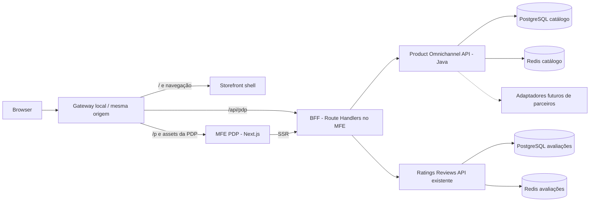

# Estudo de arquitetura: Storefront PDP

Data: 03/11/2026. Estado: estudo original, seguido de uma primeira versão implementada e validada. Projetos públicos: [storefront-pdp](https://github.com/JeffeMartins/storefront-pdp) e [product-omnichannel-api](https://github.com/JeffeMartins/product-omnichannel-api). As seções abaixo registram a proposta; os READMEs e o guia operacional do storefront descrevem o escopo efetivamente entregue e seus limites.

## 1. Objetivo e escopo

Construir uma PDP (Product Detail Page) independente, integrável a um storefront por rotas, com informações de produto/SKU, galeria, preço, estoque por canal/loja, variantes e avaliações reais da `ratings-reviews-api`. O produto principal terá pelo menos cinco avaliações fictícias persistidas, com média calculada pela API. Identidade visual e implementação serão próprias.

Categorias servem para breadcrumb e descoberta; uma PLP completa com busca facetada fica para a segunda etapa. Checkout, pagamento, reserva real de estoque e integração comercial com parceiros ficam fora da primeira entrega. O botão de adicionar ao carrinho terá comportamento de demonstração explícito, com estado local, sem simular pedido confirmado.

## 2. Referências de arquitetura e limites das conclusões

A proposta considera padrões de storefronts com aplicações por marca, componentes compartilhados, resolução de rotas no servidor e adaptadores de serviços. As referências foram examinadas estaticamente, sem executar serviços corporativos. Este documento público registra somente decisões da implementação autoral, sem nomes, revisões ou caminhos de repositórios internos.

Constatações:

| Padrão observado | Aplicação à versão própria |
| --- | --- |
| Next.js, aplicações por marca e código compartilhado | Separar aplicação, componentes comuns e configuração visual |
| Resolução de rotas e container com carregamento no servidor | Resolver o SKU no servidor e renderizar conteúdo útil no HTML |
| Serviços de produto e composição de preço/estoque por SKU | Domínios de catálogo e oferta explícitos, unidos por SKU |
| Adaptadores entre respostas externas e componentes | Contratos próprios; componentes não conhecem payload de parceiro |
| Filtros, ordenação e paginação representados na URL | Navegação reproduzível; aplicar também à paginação das avaliações |
| Carregamento de banners com tolerância a falhas | Enriquecimentos opcionais não derrubam o produto |
| Serviço de reviews por SKU e estrelas dependentes de widget externo | Substituir a dependência do widget por dados da nossa API e estrelas acessíveis |
| Dependências de bibliotecas privadas e dados ilustrativos em adaptadores | Não transportar essas dependências nem assumir que campos de exemplo são regras reais |

Os padrões de categorias/coleções e composição por SKU são referências de comportamento. A arquitetura da PDP e do catálogo Java foi definida para este portfólio, sem pressupor como serviços internos de terceiros são implementados. A escolha de composição por rotas está descrita abaixo e não depende de Module Federation.

Nenhum código, fonte tipográfica, imagem, marca, endpoint interno, credencial ou configuração corporativa será incluído nos novos projetos públicos. O histórico privado permanece privado. Este documento registra padrões e decisões próprias, sem reproduzir implementação corporativa.

## 3. Arquitetura recomendada



SSR chama a mesma camada de aplicação do BFF diretamente, sem fazer uma requisição HTTP para si próprio. O browser usa os Route Handlers para alterações de loja/canal e paginação.

### Fronteira do MFE

Recomendação: composição por rotas, com Next.js Multi-Zones, build e imagem independentes para shell e PDP. A PDP será dona de `/p/*`; o shell terá a página inicial e navegação. O gateway encaminhará também os assets com prefixo exclusivo e as rotas do BFF. Essa integração será testada no Compose, além do modo standalone da PDP.

Navegar entre zonas recarrega o documento; dentro da PDP, as interações usam navegação cliente. Esse custo é aceitável para o escopo inicial e fica documentado. Module Federation só deve ser introduzido se surgir um requisito concreto de montar componentes remotos na mesma árvore em runtime. Separar pastas dentro de uma única aplicação não demonstraria, sozinho, independência de MFE.

### BFF

O BFF reside no servidor Next.js da PDP, sem outro serviço Java apenas para agregação. Ele compõe catálogo e avaliações com chamadas independentes e concorrência limitada, valida respostas e entrega um DTO estável para a interface. Não acessa bancos diretamente. Cada integração tem timeout e tratamento de erro próprio.

Para esta PDP, uma consulta de catálogo e uma consulta de avaliações por carregamento são suficientes. Um endpoint batch de estrelas será considerado quando houver uma grade de produtos; ele não é pré-requisito para uma PDP de um SKU.

## 4. Projetos e organização proposta

| Repositório | Responsabilidade |
| --- | --- |
| `storefront-pdp` — novo | `apps/shell`, `apps/pdp`, `packages/ui`, contratos frontend, testes de navegador e Compose integrado |
| `product-omnichannel-api` — novo | Catálogo, ofertas, estoque, variantes, categorias, cache, OpenAPI e migrations |
| `ratings-reviews-api` — existente | Reviews, notas agregadas e integração opcional de IA; evolução compatível |

Esses nomes são sugestões. Os dois novos repositórios serão publicados após a validação local solicitada. O estudo fica temporariamente em `docs/` da API existente; na implementação, sua documentação de integração deve acompanhar o novo storefront.

Frontend organizado por funcionalidades (`product`, `offers`, `reviews`) e adaptadores de API; componentes comuns pequenos, CSS isolado e tokens próprios. Contratos TypeScript gerados do OpenAPI quando aplicável, com validação de runtime nas fronteiras. Backend Java organizado por domínio (`catalog`, `offer`, `inventory`) com aplicação e adaptadores; interfaces onde houver troca real de implementação. Não criar camadas vazias apenas para exibir um padrão.

Base tecnológica proposta: TypeScript strict, React e Next.js App Router em versões estáveis suportadas; Java 21, Maven Wrapper, Spring Boot estável compatível com Springdoc e Resilience4j, PostgreSQL e Redis. A seleção final de versões será fixada após um build de compatibilidade. A API existente usa Boot 3.5.16 e isso não obriga o novo projeto a usar a mesma versão; também não justifica migrar a API existente sem testes.

## 5. Modelo de dados e fonte de verdade

| Entidade no catálogo | Conteúdo e restrições principais |
| --- | --- |
| Product | UUID, SKU único, slug único, nome, descrição, marca, ativo, versão e timestamps |
| ProductImage | Produto, URL local/permitida, texto alternativo e ordem |
| ProductAttribute | Atributos de exibição, como material e dimensões; sem interpretar HTML arbitrário |
| ProductVariant | Família, SKU da variante e atributos de seleção; cada variante tem sua oferta |
| Category / ProductCategory | Hierarquia e associação; breadcrumb e produtos relacionados |
| Location | Identificador estável, nome e tipo: loja ou centro de distribuição |
| Offer | SKU, vendedor, canal, localidade, moeda, preço de lista, preço atual e versão |
| Inventory | SKU, localidade, quantidade disponível não negativa, versão e atualização |

Valores monetários: `NUMERIC(12,2)` no PostgreSQL, `BigDecimal` em Java e string decimal no JSON (`"199.90"`), sempre acompanhada da moeda. Regras: preço não negativo, preço promocional não superior ao de lista quando houver desconto, desconto derivado dos preços. Não usar ponto flutuante para calcular dinheiro.

SKU usa o contrato já existente: letras maiúsculas, números, ponto, hífen e underscore; máximo 64 caracteres. Ele é a chave de integração, não uma FK entre bancos. Catálogo é dono dos dados completos do produto. A tabela `products` da API de avaliações permanece uma referência mínima local; nenhum serviço lê o banco do outro.

Provisionamento inicial: script idempotente cadastra os mesmos SKUs nas duas APIs, com identificação explícita de cada produto. O seed compara dados existentes e não sobrescreve reviews do usuário. Falha parcial é recuperada repetindo o script, sem transação distribuída. Sincronização contínua por eventos/outbox é evolução caso passe a existir administração de produtos entre serviços.

## 6. Contratos iniciais

### Product Omnichannel API

- `GET /api/v1/products/{sku}?channel=WEB&locationId=...`: produto, imagens, atributos, variantes e oferta no contexto informado.
- `GET /api/v1/products/{sku}/availability?channel=WEB&locationId=...`: disponibilidade no contexto; informativa, sem promessa de reserva.
- `GET /api/v1/locations`: lojas e centro de distribuição fictícios disponíveis para seleção.
- `GET /api/v1/categories/{slug}`: categoria e breadcrumb; listagem com filtros virá na etapa de PLP.
- `/swagger-ui/index.html`, `/v3/api-docs` e health checks.

SKU inexistente retorna 404; indisponibilidade de serviço retorna 503. Produto válido sem estoque continua 200 com estado `OUT_OF_STOCK`. Localidade e canal são validados por allowlist/identificadores cadastrados. Para WEB, localidade representa o centro de atendimento; para retirada, a loja selecionada. Não escolher contexto silenciosamente se a combinação for inválida.

No MVP os dados comerciais serão alimentados por migrations/seed de demonstração; não haverá endpoints administrativos abertos. Uma administração futura exige autenticação e autorização explícitas.

### Ratings API e BFF

Reutilizar `GET /api/v1/products/by-sku/{sku}?page=0&size=5`, já implementado. Ele entrega produto de referência, resumo e comentários paginados. A média vem do agregado de todas as avaliações, nunca só da página visível.

BFF público: `GET /api/pdp/{sku}?channel=WEB&locationId=...&reviewPage=0&reviewSize=5`. Limites: tamanho de página até 20, índices não negativos e ordenação determinística. A rota web será `/p/{sku}/{slug}`; SKU é canônico e slug incorreto redireciona para a URL correta.

Resposta conceitual — exemplo proposto, ainda não disponível:

```json
{
  "product": { "sku": "FONE-BT-001", "name": "Fone Bluetooth Aurora" },
  "offer": {
    "status": "AVAILABLE", "currency": "BRL",
    "listPrice": "249.90", "price": "199.90",
    "channel": "WEB", "locationId": "CD-DEMO-01"
  },
  "availability": { "status": "IN_STOCK", "updatedAt": "2026-11-03T12:00:00Z" },
  "ratings": {
    "status": "AVAILABLE", "totalReviews": 5, "averageRating": 4.2,
    "reviews": { "content": [], "page": 0, "size": 5, "totalElements": 5 }
  },
  "degradedSections": []
}
```

O array vazio acima abrevia o contrato; no teste de aceitação conterá os cinco comentários reais de demonstração. O conteúdo detalhado incluirá identificador, nome de exibição, nota, título, texto e data.

Se reviews falharem, a PDP mantém o produto e retorna `ratings.status=UNAVAILABLE`, média/total `null` e aviso no bloco de avaliações. Zero avaliações só é exibido quando confirmado pela API. SKU ainda não provisionado em ratings terá estado `NOT_REGISTERED`, sem fabricar nota zero. Catálogo ausente gera 404; catálogo indisponível sem dados seguros para servir gera 503.

Filtros por estrela e ordenação de reviews não existem hoje na API. São evolução explícita que exigirá consulta, agregados e contrato próprios; o frontend não filtrará apenas os cinco itens carregados fingindo representar todos os resultados.

## 7. Cinco avaliações reais de demonstração

A restrição existente é uma avaliação por `(product_id, author)`. Os usuários locais atuais são apenas `admin` e `reviewer`; portanto, o seed atual não consegue criar cinco avaliações distintas. Além disso, `scripts/seed-demo.ps1` verifica exatamente duas avaliações e média 4,5; esse script precisa de adaptação compatível ou de substituto dedicado ao cenário integrado.

Proposta: perfil `demo` explícito na Ratings API com pelo menos cinco autores fictícios, credenciais geradas localmente e seed via HTTP, respeitando autenticação e CSRF. Nenhum endpoint permitirá enviar autor arbitrário para contornar a identidade autenticada. O perfil padrão não ganhará usuários de demonstração adicionais.

O SKU `FONE-BT-001` terá no ambiente integrado cinco reviews com notas `5, 4, 5, 3, 4`: média esperada 4,2. As duas primeiras correspondem às notas já demonstradas anteriormente. Para testes determinísticos, usar banco e volumes exclusivos do cenário integrado; dados pessoais locais anteriores não serão apagados nem alterados para forçar a média esperada. Haverá também SKU sem avaliações, produto esgotado e variante com preço diferente.

## 8. Cache, resiliência e desempenho

| Dado | Política inicial proposta | Falha |
| --- | --- | --- |
| Catálogo descritivo | Cache-aside Redis, TTL 5 min com jitter, chave versionada por SKU | Consulta ao PostgreSQL; sem requisições Redis repetidas enquanto circuito estiver aberto |
| Oferta/estoque | Cache separado, TTL 10 s, por SKU + canal + localidade + vendedor + moeda | Consultar banco; sem resposta válida, preço/estoque ficam indisponíveis |
| Resumo de avaliações | Reutilizar Redis da Ratings API, TTL atual 30 s | Fallback PostgreSQL já existente |
| Comentários | Paginação no banco da Ratings API | Bloco indisponível sem derrubar dados do catálogo |
| DTO agregado do BFF | Sem cache adicional no MVP | Evita TTLs sobrepostos e vazamento de contexto |

Next.js buscará dados comerciais explicitamente sem cache adicional; não dependerá de defaults do framework. Assets terão cache HTTP versionado. Alterar loja/canal cancela solicitações anteriores e só aplica a resposta correspondente ao contexto atual, evitando exibir preço antigo com estoque novo.

Cache limita leituras, mas TTL não dá consistência forte. Escritas futuras invalidarão após commit; corrida de refill e atraso máximo continuarão documentados. Quando houver requisito de confirmação de compra, revalidar preço e reservar estoque transacionalmente no servidor, fora do escopo desta PDP.

O BFF terá deadline total e timeouts menores por dependência. Ponto de partida para testes locais: orçamento de 2 s no BFF e timeout de 800 ms para ratings, ajustados após medição; não são SLA prometidos. Requests serão cancelados quando aplicável. Usar circuit breaker por dependência e limites explícitos de conexões/concorrência. Não adicionar retries no primeiro fluxo, evitando amplificar sobrecarga.

No Java, Resilience4j isolará Redis e adaptadores externos. Circuit breaker não impõe timeout nem limite de concorrência por si só. No BFF, implementar timeout e cancelamento desde o início; breaker com estado por processo somente se validado e justificado pelo runtime escolhido, sem anunciar proteção distribuída inexistente.

Dados descritivos e seções opcionais terão fronteiras de erro independentes. Um parceiro futuro fica atrás de adaptador com contrato próprio e stub de teste. O MVP funciona completamente offline de parceiros, usando dados fictícios no banco. Não introduzir Elasticsearch, Kafka ou Kubernetes antes de existir necessidade mensurável.

## 9. Experiência da PDP

- Galeria com imagens próprias/permitidas e textos alternativos; título, marca, SKU e breadcrumb.
- Preço em reais, desconto calculado, contexto de entrega/retirada e estoque informativo.
- Seleção de variante que troca o SKU e carrega os dados correspondentes.
- Estrelas fracionárias com texto acessível, como “4,2 de 5, com 5 avaliações”.
- Bloco com cinco reviews, paginação, estado vazio verdadeiro e aviso de indisponibilidade.
- Descrição e atributos sem HTML não confiável; estados de carregamento, erro e produto inexistente.
- Layout responsivo, teclado, foco visível e respeito à preferência de movimento reduzido.
- SEO com HTML de produto no servidor, canonical, metadata e JSON-LD Product/Offer; incluir AggregateRating apenas quando houver dados confirmados. Serialização segura para evitar injeção de scripts.

Análise por IA é uma extensão posterior: a API atual gera via POST restrito ao administrador e não persiste a análise para leitura pública. A PDP não chamará geração paga a cada visita. Para exibição pública será necessário salvar o resultado versionado, expor leitura e distinguir desabilitado, pendente e indisponível. A chave permanece no backend e a geração é uma operação administrativa explícita.

## 10. Ambiente local e segurança

O Compose integrado pertencerá ao storefront. Serviços: gateway, shell, PDP/BFF, catálogo Java, ratings Java, PostgreSQL e Redis de cada domínio. Para preservar o banco atual, a instância integrada de ratings terá seu próprio nome de projeto, rede e volume. Os dois serviços Java não compartilham tabelas, usuário de banco ou credenciais.

Porta pública proposta: `127.0.0.1:3000`; ferramentas de depuração/Swagger poderão usar portas locais exclusivas. Bancos e Redis ficam acessíveis apenas na rede Docker. O stack atual em 8080 permanece independente. Um modo leve com recarga de frontend pode reutilizar dependências Docker; perfil observability opcional terá Prometheus/Grafana, sem sobrecarregar o modo padrão.

Um bootstrap documentado verificará Docker, criará `.env` com senhas aleatórias e obterá os dois backends em revisões fixadas, com possibilidade explícita de usar checkouts locais. `docker compose up --build --wait` será o alvo de execução; o comando exato só será publicado depois de validado. Não depender de caminhos absolutos da máquina do autor ou de ferramentas portáteis em `.tools`.

Segurança: leituras públicas, sem senha administrativa no navegador; containers sem root quando compatível, imagens multi-stage, mínimos privilégios, limites de corpo/paginação, headers de segurança, proteção de mutações e allowlist de destinos e imagens. Nenhum proxy aceita URL externa arbitrária. Logs não incluem Authorization, senhas, dados de cartão ou chaves. CSP deve ser testada com a estratégia de SSR/hidratação, sem políticas anunciadas que quebrem a aplicação.

A primeira entrega pública será código-fonte reproduzível, executado em localhost. Exposição na internet exige definição do provedor, TLS, autenticação das operações administrativas, limites e gestão de segredos. Publicar o repositório não equivale a disponibilizar um servidor comercial.

## 11. Validação e evidências para o portfólio

| Verificação | Critério de aceitação |
| --- | --- |
| Seed | Repetir não duplica produto/review; cinco autores e notas persistidos no ambiente isolado |
| Integração | PDP mostra SKU, preço e estoque da API nova; cinco comentários e média 4,2 da Ratings API |
| Contexto | Trocar loja/canal/variante nunca mistura respostas; preço/estoque mudam conforme dados cadastrados |
| Segurança | Não há secrets no bundle; mutações sem autorização falham; entradas inválidas são rejeitadas |
| Falha Redis | API continua lendo do banco; teste comprova fallback e recuperação |
| Falha ratings | Produto continua visível; mensagem de indisponibilidade, sem estrelas fabricadas |
| Falha catálogo | 503 explícito; SKU desconhecido tem 404 real, inclusive no SSR |
| MFE | PDP abre standalone e pelo gateway; assets não conflitam; build independente do shell |
| Frontend | Testing Library para interações relevantes; Playwright para navegação, cinco reviews e falhas |
| Backend | JUnit/Testcontainers com PostgreSQL/Redis; contratos HTTP com stubs, sem credenciais de parceiros |
| Acessibilidade | Auditoria automatizada e teste manual de teclado; não confundir lint com acessibilidade completa |
| Performance | k6 com dataset e máquina documentados, cache quente/frio, p50/p95/p99 e erros; Lighthouse local com contexto |

O objetivo de desempenho será definido após a primeira linha de base. Não afirmar “alta performance” apenas porque existe Redis. Métricas incluem hit/miss, SQL/latência, pool de conexões, chamadas por PDP e taxa de falha. IDs de correlação atravessam BFF e APIs; métricas administrativas não ficam públicas por padrão.

README terá diagrama, vídeo/GIF ou screenshots próprios, instrução do zero, URLs, cURLs PowerShell e Bash, catálogo de SKUs, Swagger, testes, decisões arquiteturais, limitações e licença para o código autoral. CI fará build, checagem de tipos/lint, testes relevantes e verificação de dependências; publicação depende da validação do stack integrado. Artefatos de teste deixam claro o que foi executado e o que permanece proposto.

## 12. Ordem de entrega

1. Fixar contratos, identidade fictícia, stack compatível e estrutura dos dois projetos novos.
2. Implementar catálogo Java, migrations, dados sintéticos, Swagger e testes com banco/cache reais.
3. Evoluir a Ratings API com perfil demo isolado e seed de cinco autores, preservando contratos existentes.
4. Construir PDP SSR, BFF e integração de estrelas/comentários, incluindo estados de erro.
5. Integrar shell/gateway e validar independência do MFE e isolamento dos dados locais.
6. Rodar E2E, cenários de falha, segurança e medição inicial; corrigir o que os resultados indicarem.
7. Finalizar documentação, revisar ausência de material privado e publicar os repositórios públicos com CI.

Decisões assumidas para iniciar: marca fictícia, produto principal `FONE-BT-001`, idioma pt-BR, moeda BRL, dois pontos de retirada e um centro de distribuição; cinco reviews no SKU principal; sem checkout real. Outras avaliações e produtos poderão ser adicionados ao dataset sem alterar a arquitetura.

## 13. Fontes técnicas públicas consultadas

- [Next.js Multi-Zones](https://nextjs.org/docs/app/guides/multi-zones): composição por caminhos, aplicações independentes e navegação entre zonas.
- [Spring Boot: requisitos de sistema](https://docs.spring.io/spring-boot/system-requirements.html): compatibilidade do runtime e ressalva sobre bibliotecas de terceiros; conferir novamente ao fixar versões.
- [PostgreSQL: tipos numéricos](https://www.postgresql.org/docs/current/datatype-numeric.html): decimais exatos para preços.
- [Resilience4j CircuitBreaker](https://resilience4j.readme.io/docs/circuitbreaker): comportamento do circuito e necessidade de controles adicionais de concorrência.

A arquitetura acima é uma proposta própria; não descreve uma implementação interna de terceiros. Para a entrega efetiva e suas limitações, consultar os READMEs dos projetos publicados.
